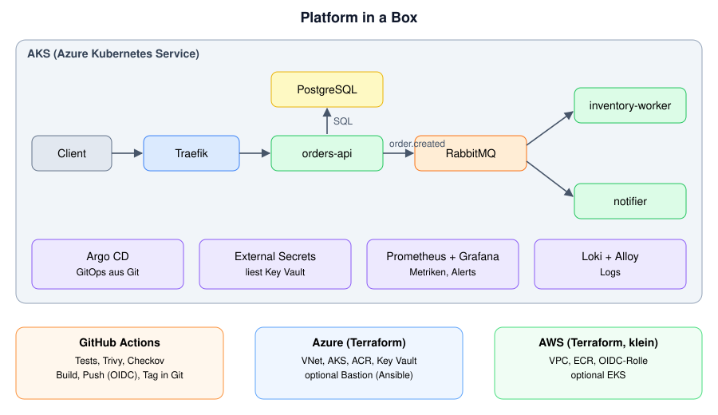

# Platform in a Box

A small event-driven shop, built and operated like a platform team would: infrastructure as code on **Azure and AWS**, **Kubernetes** with **GitOps**, **CI/CD** with security scanning, **monitoring, logging and incident management**.

The application is intentionally tiny. The platform around it is the point.

> Deutsche Kurzfassung am Ende dieser Datei.



## What is in the box

| Area | What you find here | Where |
|---|---|---|
| Microservices, event-driven, API-first | `orders-api` (FastAPI, OpenAPI), `inventory-worker`, `notifier`, RabbitMQ topic exchange, PostgreSQL | `apps/`, `docs/adr/0003-*` |
| Containers | Non-root, minimal Dockerfiles, Compose stack for local work | `apps/*/Dockerfile`, `docker-compose.yml` |
| Kubernetes | Helm chart: probes, limits, HPA, PDB, NetworkPolicies, security contexts | `charts/shop/` |
| IaC | Terraform modules for Azure (VNet, AKS, ACR, Key Vault, optional bastion) and AWS (VPC, ECR, GitHub OIDC role, optional EKS); Ansible hardening playbook; Helm | `infra/`, `ansible/`, `charts/` |
| GitOps | Argo CD app-of-apps with sync waves | `gitops/` |
| CI/CD | Tests, lint, Helm/Terraform validation, Trivy, Checkov, OIDC login, image build/scan/push, tag bump, `terraform plan` on PRs, gated `apply` | `.github/workflows/` |
| Secrets | Key Vault + External Secrets Operator with workload identity | `infra/azure/`, `gitops/platform/` |
| Policy / security | Pod Security, Kyverno policies, default-deny network rules | `gitops/platform/manifests/`, `charts/shop/templates/networkpolicy.yaml` |
| Tests | Unit tests per service, relay tests, end-to-end smoke test in CI (`docker compose` + `scripts/smoke-test.sh`), Ansible syntax check and lint | `apps/*/tests`, `scripts/smoke-test.sh`, `.github/workflows/ci.yml` |
| Monitoring and logging | kube-prometheus-stack, alert rules, Grafana dashboard, Loki + Alloy, structured JSON logs | `charts/shop/templates/monitoring.yaml`, `gitops/platform/values/` |
| Incident management | Severity model, runbooks, post-mortem template, failure-injection game day | `docs/`, `scripts/gameday.sh` |
| Linux and scripting | Bash scripts, Ansible hardening (SSH, ufw, fail2ban, auditd, sysctl), Python CLI `pctl` | `scripts/`, `ansible/`, `tools/pctl/` |
| Decisions | Six short ADRs | `docs/adr/` |

Architecture diagram and delivery flow: [`docs/architecture.md`](docs/architecture.md).

## Quick start

### A) Local, 2 minutes (Docker only)
```bash
docker compose up --build
curl -s -X POST localhost:8080/orders -H 'content-type: application/json' \
     -d '{"item_id":"sku-1001","quantity":2,"customer_email":"ada@example.com"}'
open http://localhost:8080/docs        # interactive OpenAPI
open http://localhost:15672            # RabbitMQ UI (guest/guest)
docker compose logs -f inventory-worker notifier
./scripts/smoke-test.sh                 # end-to-end check (needs curl and jq)
```
Older Docker setups only have `docker-compose`; the Makefile accepts `make up COMPOSE=docker-compose`.

If you ran an earlier version: recreate the broker once (`docker compose down -v`), because the queues now carry dead-letter arguments (ADR 0007).

### B) Local Kubernetes (kind, no cloud account)
```bash
make kind          # builds images, creates the cluster, installs the Helm chart
kubectl -n shop port-forward svc/orders-api 8080:8080
make kind-down
```

### C) Azure with GitOps (the real thing)
Prerequisites: Azure subscription, `az`, `terraform >= 1.10`, `helm`, `kubectl`, `jq`; a GitHub repository holding this code.

1. `az login`, then `./scripts/bootstrap-tfstate.sh` (state storage, writes `backend.hcl`).
2. `GITHUB_REPO=owner/repo ./scripts/bootstrap-azure-oidc.sh`, then set the printed GitHub **variables**. Create the GitHub Environment `dev` with a required reviewer.
3. Infrastructure:
   ```bash
   cd infra/azure/envs/dev
   cp terraform.tfvars.example terraform.tfvars   # set subscription_id
   terraform init -backend-config=backend.hcl
   terraform apply
   ```
   Add the output `acr_name` as GitHub variable `ACR_NAME`.
4. Fill the placeholders and push:
   ```bash
   REPO_URL=https://github.com/owner/repo.git SHOP_HOST=shop.example.com LE_EMAIL=you@example.com \
     ./scripts/configure-gitops.sh
   git add -A && git commit -m "configure gitops" && git push
   ```
5. `./scripts/install-argocd.sh`. Argo CD now installs the platform (cert-manager, External Secrets, Kyverno, Prometheus stack, Traefik, Loki, Alloy) and the shop.
6. The first CI run on `main` builds the images and writes the tag into `values-azure.yaml`; Argo CD rolls it out. Check with `kubectl -n argocd get applications` and `python tools/pctl/pctl.py pods -n shop`.
7. Grafana: `kubectl -n monitoring port-forward svc/kps-grafana 3000:80`; user `admin`, password from `kubectl -n monitoring get secret grafana-admin -o jsonpath='{.data.admin-password}' | base64 -d` (generated by `install-argocd.sh`).
8. Practise incidents: [`docs/game-day.md`](docs/game-day.md).

**Cost:** the two AKS nodes are the main cost. Run the cluster for your work sessions and `terraform destroy` afterwards. The same applies to AWS with `enable_eks = true` (EKS and NAT gateway are billed hourly). Check current prices before you start.

### Optional: AWS
```bash
./scripts/bootstrap-aws-state.sh
cd infra/aws/envs/dev && cp terraform.tfvars.example terraform.tfvars   # set github_repository
terraform init -backend-config=backend.hcl && terraform apply
```
ECR repositories and the GitHub OIDC role cost nothing while idle. Set `enable_eks = true` only for a demo session.

### Optional: bastion host with Ansible
Set `enable_bastion = true`, `allowed_ssh_cidr` (your IP) and `ssh_public_key` in `terraform.tfvars`, apply, then:
```bash
cd ansible && cp inventory.ini.example inventory.ini   # put the bastion IP in
ansible-galaxy collection install -r requirements.yml
ansible-playbook playbooks/bastion.yml --check --diff && ansible-playbook playbooks/bastion.yml
```

## Demo und Belege

<!-- Erst eintragen, wenn es sie wirklich gibt (siehe docs/azure-runbook.md):
- Demo-Video (2 Min.): <Link>
- Screenshots: docs/screenshots/
- Post-Mortem der Störungsübung: docs/<dein-post-mortem>.md
-->
Schritt-für-Schritt-Anleitung für den Azure-Durchlauf: [`docs/azure-runbook.md`](docs/azure-runbook.md).

## Status: what was verified, and what was not

Checked while building this repository: Python sources compile; the unit tests that need no third-party packages pass (inventory logic, notification rendering, `pctl`); all YAML and JSON files parse; shell scripts pass `bash -n`; Helm template blocks are balanced.

**Not run yet** (no network, no cloud account, no tools available when it was generated): `pytest` for `orders-api` (needs FastAPI), `helm lint/template`, `terraform validate/plan`, `ansible-playbook`, Docker builds and every cloud deployment. Expect to fix small things on the first run: provider argument names, chart value keys and Helm chart versions change over time. CI runs these checks on the first pull request, so start with `make test helm tf-validate` locally and fix what they report.

Helm chart versions in `gitops/apps/*.yaml` are set to `"*"`. After the first successful sync, pin each one to the exact version that was installed.

A static review (what passed, what was fixed, what is still open) is in [`docs/review-findings.md`](docs/review-findings.md).

## Known gaps
See "Known simplifications" in [`docs/architecture.md`](docs/architecture.md): polling relay instead of a full outbox, in-cluster data stores for dev, no image signing, no backups, no private endpoints.

---

## Deutsche Kurzfassung

Kleiner, ereignisgetriebener Shop (3 Microservices + RabbitMQ + PostgreSQL), betrieben wie von einem Platform-Team: Terraform für Azure (Haupt-Umgebung) und AWS (klein), Kubernetes mit Helm und Argo CD (GitOps), CI/CD mit Trivy/Checkov und OIDC-Login ohne gespeicherte Zugangsdaten, Secrets über Key Vault, Monitoring mit Prometheus/Grafana/Loki, Runbooks, Post-Mortem-Vorlage und ein Game Day zum Üben von Störungen.

Einstieg: `docker compose up --build` (lokal), `make kind` (lokales Kubernetes) oder der Azure-Weg in Abschnitt C. Preise vor dem Start prüfen und die Cloud-Umgebung nach jeder Sitzung mit `terraform destroy` entfernen.
