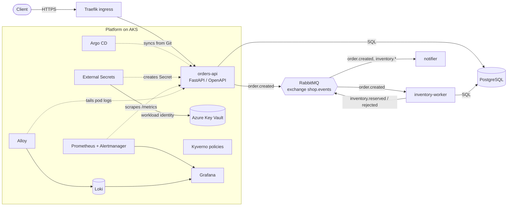

# Architecture

## Delivery flow

1. Pull request: tests, lint, `helm lint/template`, `terraform fmt/validate`, Trivy and Checkov. Infrastructure changes also get a `terraform plan` comment.
2. Merge to `main`: images are built, scanned with Trivy and pushed to ACR (OIDC login, no stored credentials).
3. CI writes the new image tag into `charts/shop/values-azure.yaml` and commits. That commit is the deployment record.
4. Argo CD notices the commit and rolls out the chart. `selfHeal` reverts manual drift; `prune` removes deleted resources.
5. `terraform apply` for infrastructure runs on `main` behind the GitHub Environment `dev` (manual approval).

## Environments and clouds

| Part | Azure (primary) | AWS (secondary) |
|---|---|---|
| Network | VNet, AKS subnet, management subnet | VPC (NAT only when EKS is on) |
| Registry | ACR, pull via kubelet identity | ECR, immutable tags, scan on push |
| Kubernetes | AKS (Azure CNI overlay, Calico policies, workload identity) | optional EKS managed node group |
| Secrets | Key Vault via External Secrets | not wired up |
| CI identity | OIDC federated credential | OIDC role limited to ECR push from `main` |

## Security layers

- Pipeline: no long-lived cloud credentials, image scan before push, IaC scan, secret scan.
- Cluster: Pod Security `baseline` enforced (`restricted` as warning), non-root containers, read-only root filesystem for apps, dropped capabilities, default-deny ingress and egress NetworkPolicies with explicit allows (DNS, data stores, ingress controller, Prometheus), Kyverno rules (no `:latest`, limits required, approved registries).
- Secrets: generated by Terraform, stored in Key Vault, synced into the cluster by External Secrets with workload identity.

## Known simplifications (what I would do next)

- Orders are retried by a polling relay (ADR 0007), not a full transactional outbox. Several API replicas may publish the same order; consumers are idempotent.
- PostgreSQL and RabbitMQ run in the cluster for the demo; production would use managed services (ADR 0006). Services open one database connection per call; a pool is the next step.
- Not implemented: Azure AD RBAC for the cluster, private Key Vault endpoint, private cluster API, image signing (cosign + Kyverno verifyImages), backups, SLO-based alerting.
- Grafana is only reachable via port-forward. Its admin password is generated at install time (Secret `grafana-admin`), not stored in Git.
